# C 调用 CPU 与 GPU 12 步图文操作

[返回实验说明](README.md) · [下载原始 Word](reports/C调用CPU与GPU.docx)

正文按原报告的步骤整理，图片直接使用报告中的 19 张原图。Word 与图片保持原样；本网页将构建脚本和调试工程的入口更新为当前目录。

先在资源管理器打开本实验文件夹 `labs/01-c-cpu-gpu`，在地址栏输入 `powershell` 并回车。下列命令都从这个实验根目录执行；不是从仓库根目录执行。

第 6～12 步继续同一次 Step08 调试。第 10 步的独立实验 09，等 Step08 正常退出后再运行。

## 第 1 步 编译并运行环境检查

1. 打开实验根目录的 PowerShell，执行以下命令确认当前位置。

```powershell
Get-Location
```

2. 编译CPU程序。执行完第一条后，再输入第二条检查退出码。

```powershell
.\scripts\build_cpu.cmd
$LASTEXITCODE
```

3. 编译GPU程序，同样检查退出码。两个构建脚本退出码均应为0。

```powershell
.\scripts\build_gpu.cmd
$LASTEXITCODE
```

4. 检查生成的文件。

```powershell
Get-Item .\bin\cpu_labs_Od.exe, .\bin\gpu_labs.exe
Get-Item .\build\kernels.ptx, .\build\kernels.cubin
```

5. 运行实验01，查看电脑环境信息。后续PowerShell命令都在本目录执行。

```powershell
.\bin\cpu_labs_Od.exe 01
```

原报告的环境输出：

```text
Hello from C.
Windows: 10.0.26200 (x64)
CPU: Intel(R) Core(TM) i9-14900HX
Logical processors: 32
MSVC: _MSC_VER=1941, _MSC_FULL_VER=194134123
NVCC: Cuda compilation tools, release 12.6, V12.6.20
cuobjdump: Cuda compilation tools, release 12.6, V12.6.20
GPU, driver: NVIDIA GeForce RTX 4060 Laptop GPU, 560.94
Pointer size: 8 bytes
```

运行截图  环境检测的实际输出

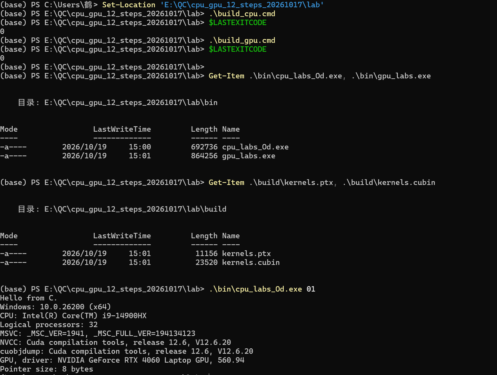

## 第 2 步 查看进程与线程

1. 在当前 PowerShell 执行以下命令，用 Visual Studio 2022 打开调试方案。

```powershell
Invoke-Item .\debug\Step02.sln
```

2. 确认平台为x64，按F5；停在DebugBreak时保持暂停。

3. 查看顶部“进程”编号；点击“调试 → 窗口 → 线程”查看线程编号。

4. 点击“调试 → 窗口 → 调用堆栈”，保持暂停，继续第3步。

运行截图  暂停时的进程与调用堆栈

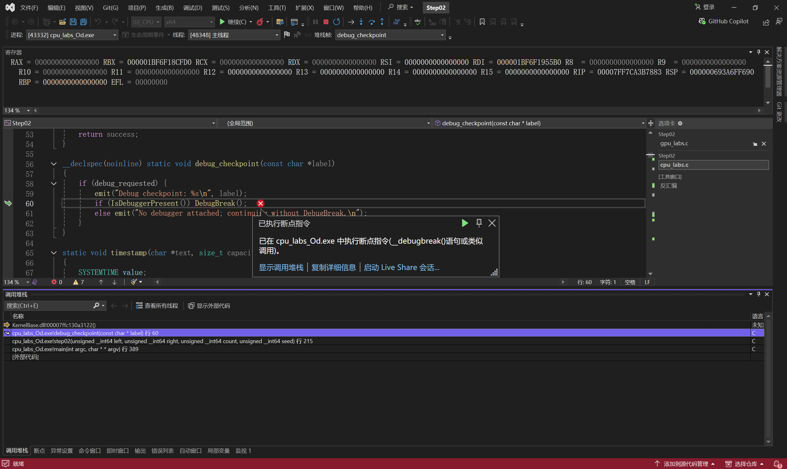

## 第 3 步 单步执行C加法

1. 在调用堆栈双击step02。打开src\cpu_labs.c，按Ctrl+G到215行，按F9设置断点，再按F5。

2. 打开“调试 → 窗口 → 局部变量”，查看left=37、right=19。按F11进入demo_add。

3. 打开“调试 → 窗口 → 反汇编”和“寄存器”。单击反汇编窗口，按F10执行几条指令。

4. 取消本步断点，按F5结束。也可用以下命令重跑，查看56、703、50396012及PASS。

```powershell
.\bin\cpu_labs_Od.exe 02 --a 37 --b 19 --n 100000 --seed 17
```

运行截图  demo_add 的源码、寄存器与局部变量

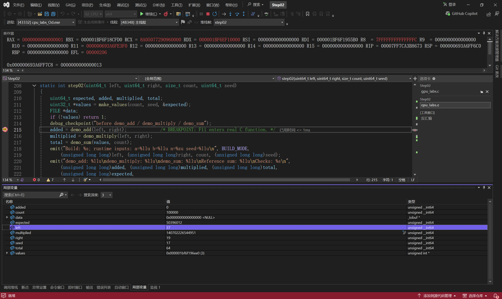

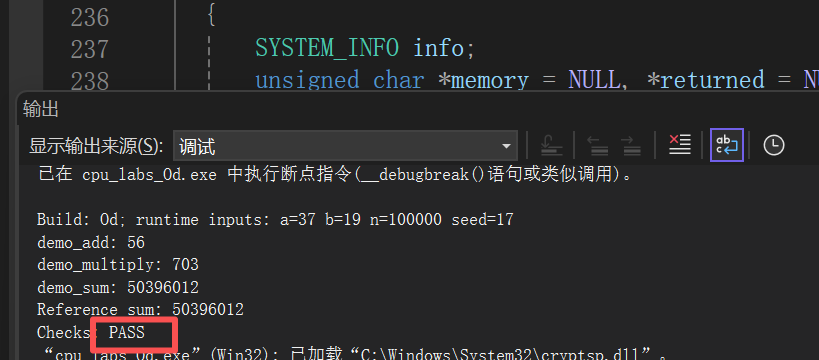

## 第 4 步 申请内存并读写文件

1. 上个程序结束后，打开debug\Step03.sln。打开src\cpu_labs.c，Ctrl+G到248行，F9设断点，再F5；若先停在DebugBreak，再F5。

2. 打开“调试 → 窗口 → 局部变量”。先看bytes=4096、memory=NULL；按F10后，memory应为非空地址。

3. 打开“调试 → 窗口 → 调用堆栈”，查看当前位置；按F5运行到退出。

运行截图  VirtualAlloc 执行后的局部变量

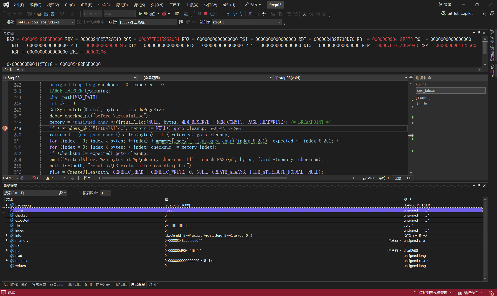

### 查看内存与文件结果

1. 切回PowerShell，保持当前目录为实验根目录。

2. 查看回读PASS、CloseHandle和VirtualFree成功记录。

```powershell
Get-Content .\results\03_Od_stdout.txt
```

3. 核对Memory checksum为505160，WriteFile与ReadFile均为4096 bytes。

运行截图  内存与文件回读日志

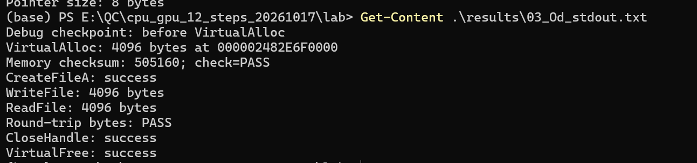

## 第 5 步 创建工作线程

运行截图  线程窗口

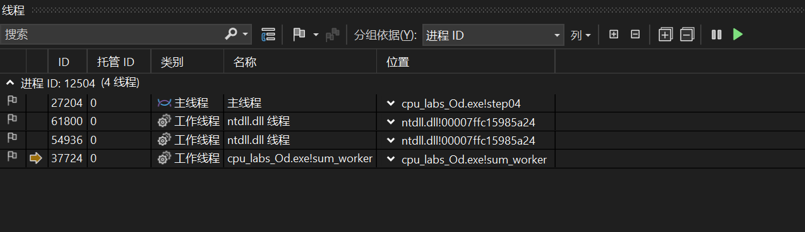

1. 在PowerShell运行实验04。

```powershell
.\bin\cpu_labs_Od.exe 04 --n 1000000 --seed 17
```

2. 查看各组的 workers、TID、range 和 sum；各组总和应为503993310，检查结果为PASS。

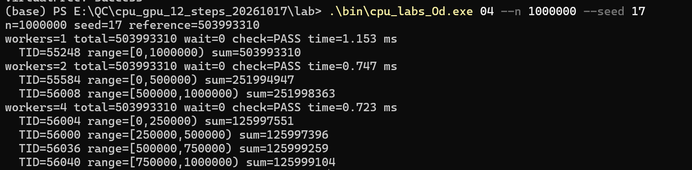

3. 打开 debug\Step04.sln，确认顶部平台为x64。

4. 打开 src\cpu_labs.c，搜索 sum_worker，在 worker->thread_id = GetCurrentThreadId(); 行按F9。

5. 按F5进入工作线程，按F10执行赋值。打开“调试 → 窗口 → 线程”，在局部变量中展开worker，查看thread_id、first和end。

6. 在断点行再按F9取消断点，然后按F5运行到结束；若仍停在自带 DebugBreak，继续按F5。

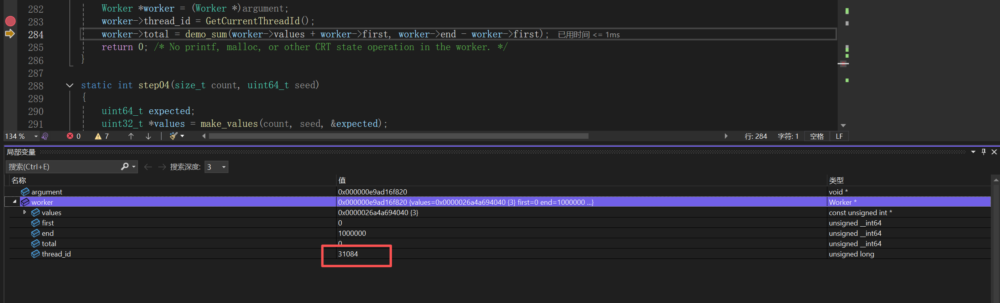

运行截图  调试运行日志（时间包含断点暂停）

## 第 6 步 初始化CUDA并加载GPU代码

1. 打开 debug\Step08.sln，打开 src\gpu_labs.c。

2. 按Ctrl+G跳到第150行，在 cuInit(0) 所在行按F9；再到第323行设置第二个断点。

3. 按F5，程序停在cuInit。用F10依次执行cuInit、cuDeviceGet、cuCtxCreate、cuModuleLoad，直到黄色箭头停在第157行。

4. 按F5，继续到第323行的 cuMemAlloc。保持程序暂停，接着做第7步。

运行截图  初始化与模块加载执行后

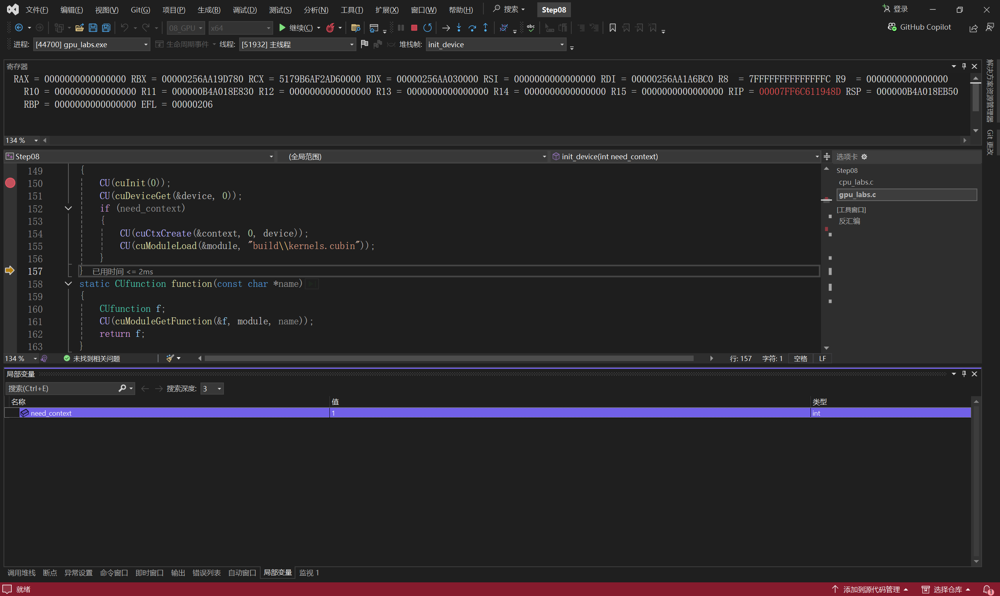

## 第 7 步 申请显存并上传数据

1. 停在gpu_labs.c第323行时，打开“调试 → 窗口 → 局部变量”，查看n=257、bytes=1028。

2. 按三次F10，执行da、db、dc的cuMemAlloc；查看三个设备地址。

3. 再按两次F10，执行两次cuMemcpyHtoD，上传A和B。

4. 在局部变量中展开A、B，首值应为0、128.5。保持调试，继续第8步。

运行截图  显存申请和上传完成后的局部变量

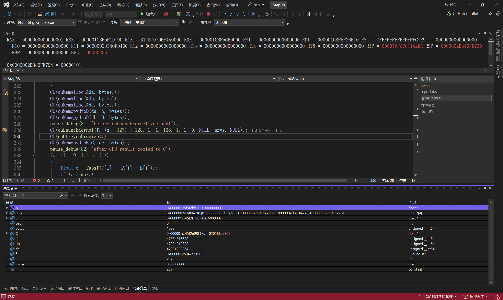

## 第 8 步 启动GPU核函数

1. 在gpu_labs.c第329行按F9，再按F5；若先停在DebugBreak，再按F5。

2. 查看启动语句：n=257，grid为3，block为128。

3. 查看函数开头的args，确认为&da、&db、&dc、&n。

4. 按F10执行cuLaunchKernel，停在第330行。保持暂停，继续第9步。

运行截图  cuLaunchKernel 执行后

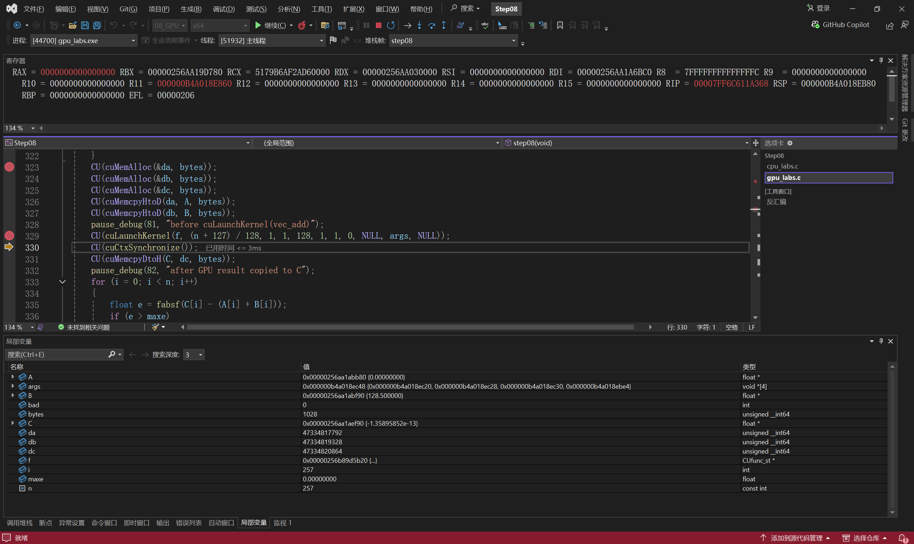

## 第 9 步 查看CUDA驱动模块

1. 保持 Step08 暂停，点击“调试 → 窗口 → 模块”。

2. 在模块列表中找到nvcuda.dll，单击选中该行。

3. 查看选中行的名称和路径列；若路径列未完整显示，拖宽该列。

4. 返回 gpu_labs.c 的 step08，保持暂停，接着做第10步和第11步。

运行截图  当前进程已加载的 nvcuda.dll

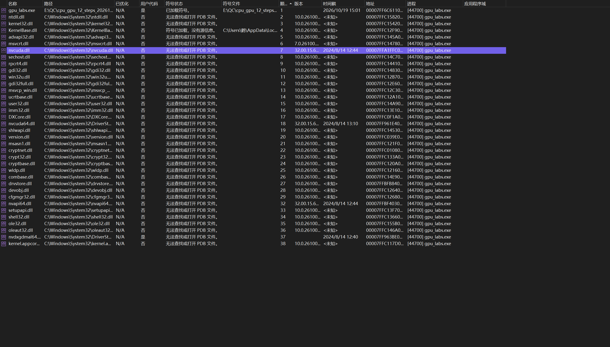

## 第 10 步 查看GPU线程编号

1. 保持 Step08 暂停，打开 src\kernels.cu，找到 vec_add。

2. 定位 int i = blockIdx.x * blockDim.x + threadIdx.x;，再查看下方 if (i < n) 和 C[i] 的赋值。

3. 先返回 Step08，完成第11步与第12步。等该程序正常退出后，再执行以下独立实验。

4. 在PowerShell运行实验09。

```powershell
.\bin\gpu_labs.exe 09
```

5. 查看线程映射与覆盖检查；找到连续下标、visits及guard相关的PASS记录。

```powershell
Get-Content .\results\09_run.log
```

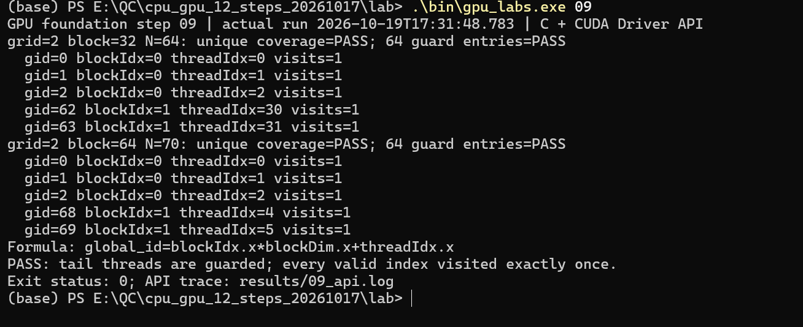

运行截图  实验09的实际线程映射结果

## 第 11 步 等待完成并下载结果

1. 回到Step08的gpu_labs.c，确认黄色箭头停在第330行cuCtxSynchronize。

2. 按两次F10，执行cuCtxSynchronize和cuMemcpyDtoH，停在第332行。

3. 打开“调试 → 窗口 → 局部变量”，展开A、B、C，首值应依次为0、128.5、128.5。

4. 保持调试，接着做第12步；下面的日志检查在程序正常退出后进行。

运行截图  结果下载后C数组的首值

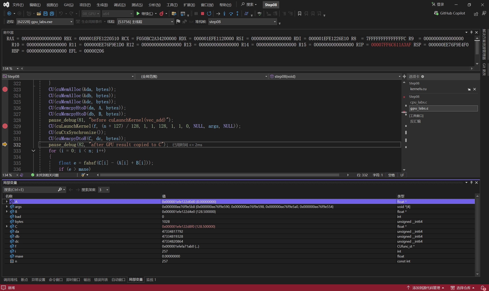

### 查看完整计算结果

1. 先完成第12步，等程序正常退出后，再回到PowerShell。

2. 输入以下命令，查看完整结果日志。

```powershell
Get-Content .\results\08_run.log
```

3. 核对C[0]=128.5、C[256]=64.5、exact equality=257/257和max_error=0。

4. 找到PASS与Exit status: 0。

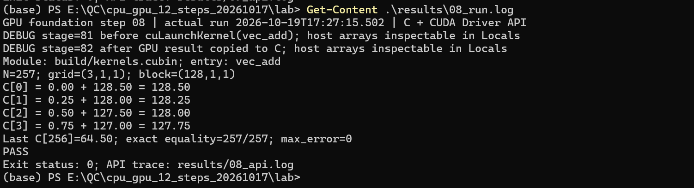

运行截图  完整结果校验日志

## 第 12 步 释放资源并检查完整结果

1. 在gpu_labs.c第346行按F9，再F5；若先停在DebugBreak，再F5。

2. 连续三次F10释放da、db、dc，停在349行。取消断点，F5到正常退出，查看返回码0。

3. 查看257/257、max_error=0、PASS和Exit status: 0。

```powershell
Get-Content .\results\08_run.log
```

运行截图  三块显存释放后

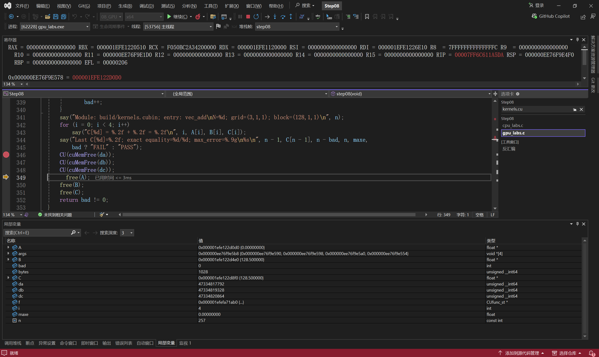

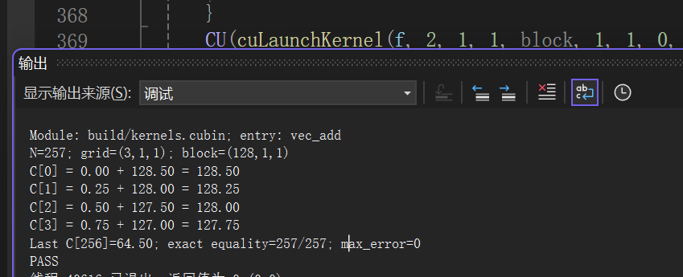

### 查看资源释放结果

1. 程序正常退出后，切回PowerShell。

2. 查看接口日志末尾的释放记录，再补跑第10步实验09。

```powershell
Get-Content .\results\08_api.log
```

3. 核对cuMemFree、cuModuleUnload、cuCtxDestroy均返回0 CUDA_SUCCESS。

运行截图  接口日志中的释放、卸载与上下文销毁成功记录

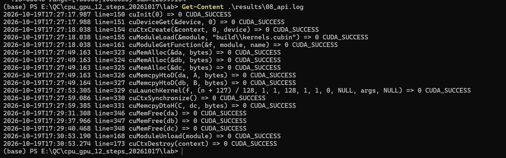

## 结果记录

原报告中的运行日期为 2026-10-19。完整线程结果见报告截图和 [日志附录摘录](runs/2026-10-19-01/report-transcript.txt)；历史原始日志的完整性说明见 [批次记录](runs/2026-10-19-01/README.md)。

当前重新运行的日志写入实验根目录的 `results`。需要归档时，按 [实验说明](README.md) 保存为新的运行批次，不覆盖历史证据。
