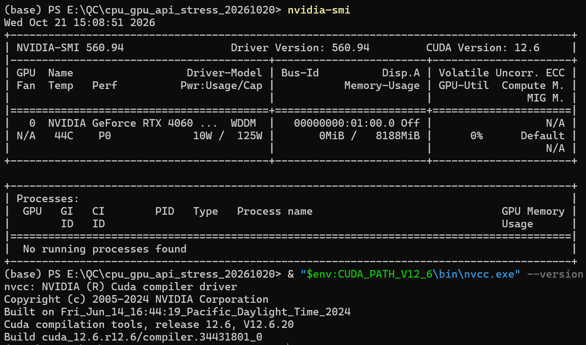
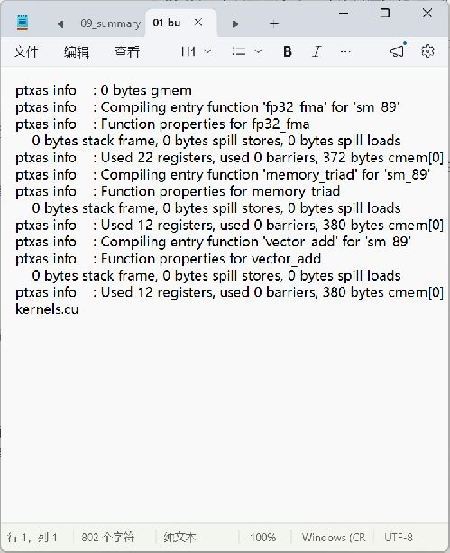
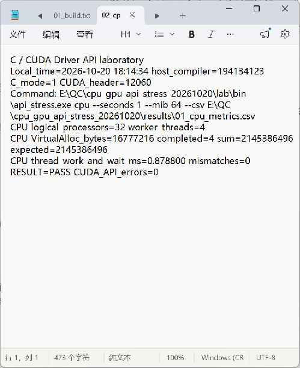
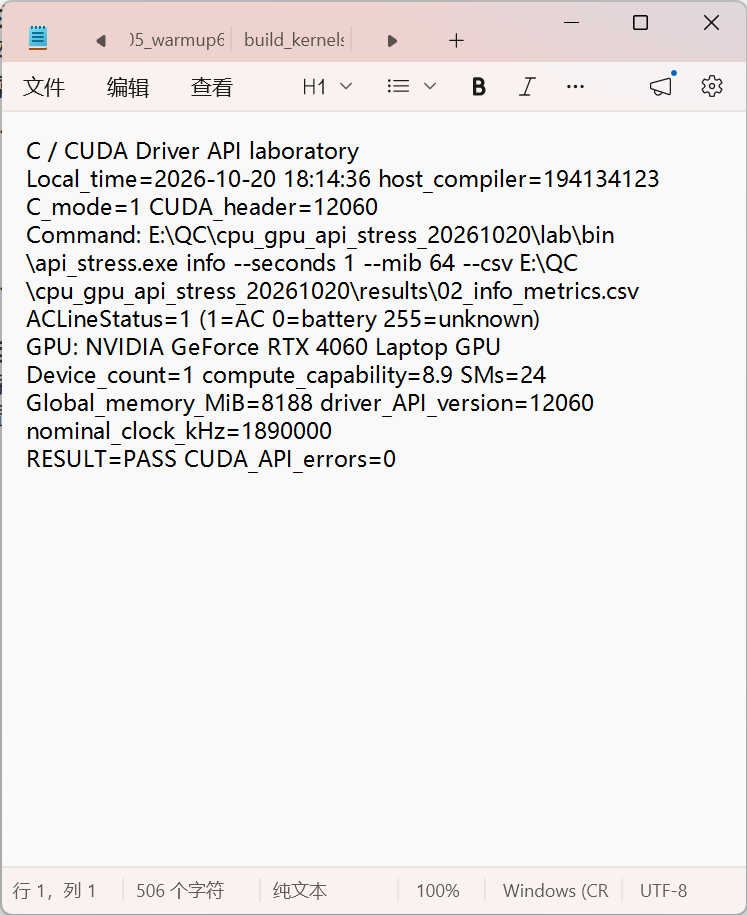
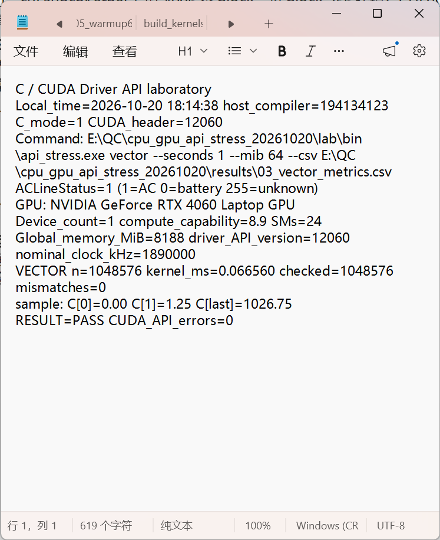
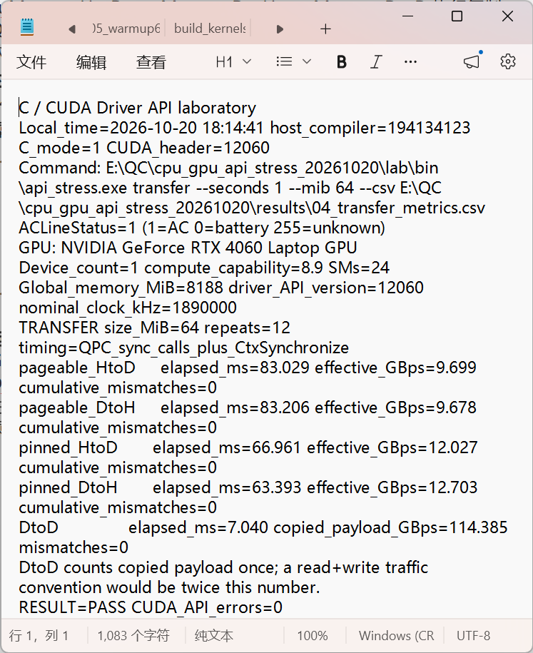
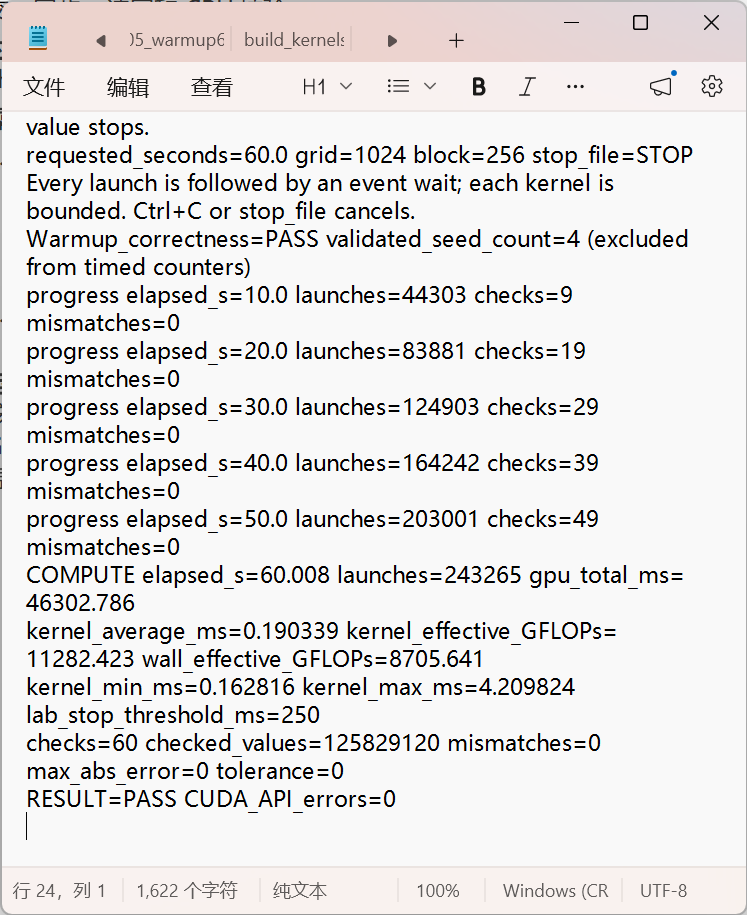
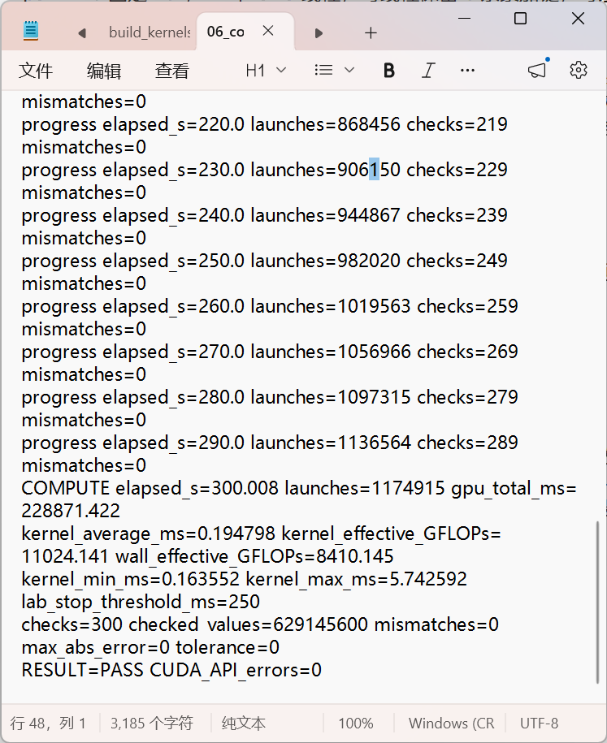
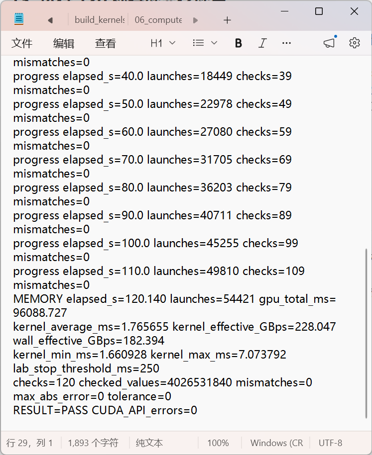
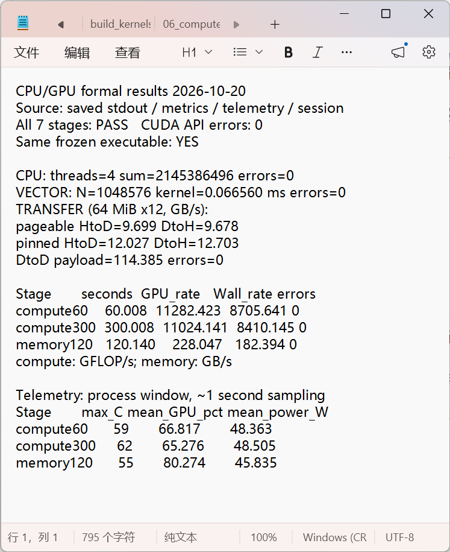

# 02 图文操作：接口验证与单卡压力测试

先读[环境与构建要求](README.md#1-环境与构建)。以下从本实验根目录执行；截图来自真实历史记录，保留原窗口内容。新运行请保存到自己的批次，不覆盖已入库记录。

## 1. 确认机器与构建

在 PowerShell 执行：

```powershell
nvidia-smi
.\scripts\build.cmd
$LASTEXITCODE
```

构建出现 BUILD PASS、退出码为 0。主机程序以 C 编译；设备核函数单独生成 cubin，再由主机加载。





## 2. CPU 四线程与设备查询

```powershell
$qcRun='.\runs\my-full-01\logs'
.\scripts\run_monitored.ps1 -Mode cpu -Label 01_cpu -OutputDirectory $qcRun
.\scripts\run_monitored.ps1 -Mode info -Label 02_info -OutputDirectory $qcRun
```

CPU 程序创建 4 个工作线程，把求和任务分块，再等待并合并。历史实际和、参考和都是 2145386496，校验错误为 0。[完整 CPU 输出](runs/2026-10-20-01/logs/01_cpu_stdout.txt)。GPU 查询显示设备名、显存和计算能力。





## 3. GPU 向量加法

```powershell
.\scripts\run_monitored.ps1 -Mode vector -Label 03_vector -OutputDirectory $qcRun
```

程序分配三份显存，复制输入，启动核函数，下载结果，与 CPU 参考数组逐元素比较。历史 1,048,576 个元素全部一致，核函数 0.066560 ms。



## 4. 主机与设备、设备内传输

```powershell
.\scripts\run_monitored.ps1 -Mode transfer -MiB 64 -Label 04_transfer -OutputDirectory $qcRun
```

测试 64 MiB、12 次重复，比较可分页内存和页锁定内存上传/下载，再测设备内复制。数据搬运计时与持续计算计时分开；H→D 带宽不能写成显存带宽。



## 5. 预热与持续计算

先完成 README 中的短时检查，再执行：

```powershell
.\scripts\run_monitored.ps1 -Mode compute -Seconds 60 -MiB 64 -Label 05_warmup60 -OutputDirectory $qcRun
.\scripts\run_monitored.ps1 -Mode compute -Seconds 300 -MiB 64 -Label 06_compute300 -OutputDirectory $qcRun
```

核函数执行 FP32 FMA 链；四组种子轮换，周期性下载并验证整份结果。记录核函数吞吐和包含主机开销的墙钟吞吐。历史 300 秒完成 300 次周期检查、0 错误，最高 62℃。





## 6. 显存读写

```powershell
.\scripts\run_monitored.ps1 -Mode memory -Seconds 120 -MiB 128 -Label 07_memory120 -OutputDirectory $qcRun
```

三个 128 MiB 数组执行 C=A+2B，两读一写。历史 120 次周期检查、0 错误，核函数带宽 228.047448 GB/s，墙钟带宽 182.393572 GB/s，最高 55℃。这里只验证本次分配的 384 MiB 数据区。



## 7. 汇总与归档

```powershell
python .\scripts\summarize_results.py $qcRun
Get-Content "$qcRun\08_summary.txt"
```

检查七项状态、错误数、退出码、实际时长和监控数据，不以单张截图或利用率判断通过。新截图放在本批次 `screenshots`；代码仍放 `src`，新的报告放 `reports`。已有汇总文件不会自动覆盖。



完整的接口参数见 [60 项参考表](reference/api-reference.md)，调用逻辑与计时口径见 [README](README.md)。
