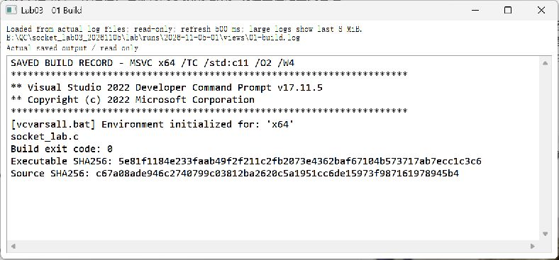
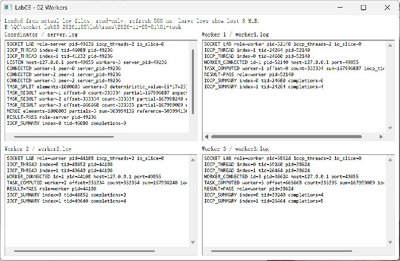
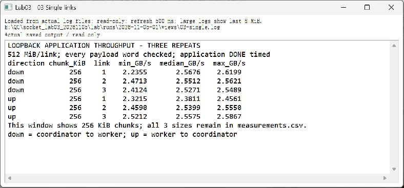
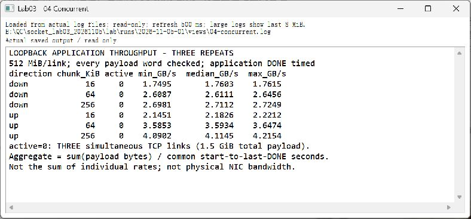
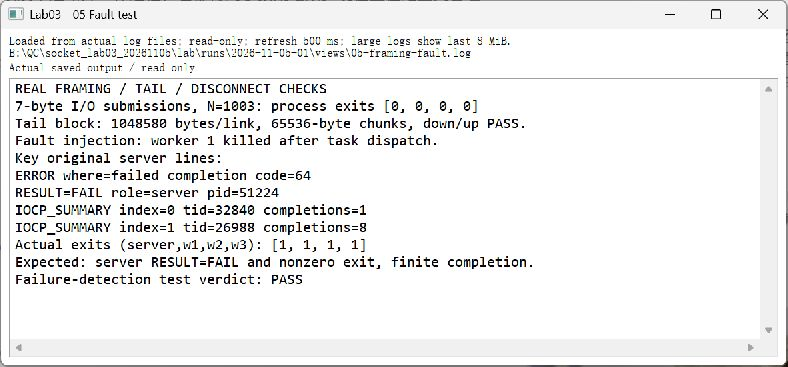
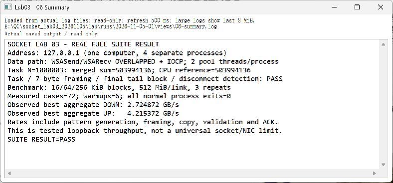

# 实验三 图文操作

先打开 [README](README.md) 的“先编译，再运行”。以下命令从本实验的 `03-socket-async` 根目录执行，运行使用新的批次名。截图来自 `runs/2026-11-05-01/screenshots` 中实际窗口；截图中的 PID、端口和路径是当时记录，不需要照抄。

## 1 编译 C 程序和结果查看器

```powershell
.\scripts\build.cmd
$LASTEXITCODE
.\scripts\build_viewer.cmd
$LASTEXITCODE
```

确认两次 PASS、退出码 0。`socket_lab.c` 是网络与计算主程序；`result_viewer.c` 是只读 Win32 日志窗口。构建脚本加载 VS 2022 x64 工具链，前者链接 Winsock。



## 2 运行一对多任务并看合并结果

初次可双击 `启动演示.cmd`；也可以直接执行下面的快速检查。`python` 应为已配置的 Python 解释器。

```powershell
python .\scripts\run_suite.py --out runs/my-quick-01
.\bin\result_viewer.exe --dir .\runs\my-quick-01\01-task
```

脚本启动一个协调者、三个 worker。C 程序建立 TCP 连接，关联 IOCP，以每进程两个完成线程处理重叠收发。协调者将 N=1,000,003 的整数数组分成 333,334、333,334、333,335 个元素的三片。

实际局部和分别为 167,996,887、167,998,240、167,999,009；合并和与单线程参考值均为 **503,994,136**。查看 `01-task/session.json`，四个进程退出码应为 0。



## 3 查看每条链路单独测量

要复现正式性能表，执行完整模式。已有批次不能覆盖；下一次改为 `my-full-02` 等新名字。

```powershell
python .\scripts\run_suite.py --out runs/my-full-01 --full
.\bin\result_viewer.exe --dir .\runs\my-full-01\bench-down-c262144-a1-r1
```

`down/up` 是两个方向，`c262144` 是 256 KiB 块，`a1` 是仅 worker 1 传载荷，`r1` 是第一轮。正式模式还分别测 `a2`、`a3`；其他连接在线但不参与该次载荷传输。

每链路每轮传 512 MiB。收到应用层确认后，协调者输出 `CSV,link` 与 `CSV,aggregate`。`GBps` 用十进制 GB/s，`Gbps` 是十进制 Gbit/s，不是同一单位。



## 4 查看三链路并发与合计吞吐

```powershell
.\bin\result_viewer.exe --dir .\runs\my-full-01\bench-up-c262144-a0-r1
```

`a0` 表示三个 worker 同时传输，各 512 MiB，总载荷 1.5 GiB。数据按位置生成并逐个 32 位数据词检查；`pattern_errors=0` 才通过。协调者用同一个开始时刻，到最后一条链路收到 DONE 为结束，按总字节除以这个共同窗口计算合计吞吐。

每条连接的发送是有序队列，跨连接可以同时有 I/O 等待完成。`WSA_IO_PENDING` 是成功挂起；不能把“必须等一个 worker 完成后再服务下一个”的串行逻辑当成这项并发测量。



## 5 检查分帧、尾块与故障

上面的 quick/full 命令均自动执行以下检查，不必手动终止正在运行的其他程序：

- `02-fragmented`：N=1003，每次最多提交 7 字节收发，跨多次完成仍能拼出完整消息。
- `03-tail-down`、`03-tail-up`：每链路 1,048,580 字节，64 KiB 块，处理剩余 4 字节尾部。
- `04-disconnect`：本轮启动的 worker 1 被故意终止，协调者应输出 FAIL、非 0 退出；外层验收为 PASS，表示错误被正确发现。

```powershell
.\bin\result_viewer.exe --dir .\runs\my-full-01\04-disconnect
```

TCP 是字节流，接收端按消息头中的长度累积正文；发送方提交多少次与接收方完成多少次不必相等。完整性看协议状态与内容校验，不看两个日志行数是否相同。



## 6 读汇总并保留每轮证据

```powershell
.\bin\result_viewer.exe --file .\runs\my-full-01\summary.log
```

正式批次是 72 组测量，加 6 次预热；每项三轮统计最小、中位和最大值。下面是本机正式批次的中位数，单位 GB/s：

| 方向 | 块大小 | worker 1 单测 | worker 2 单测 | worker 3 单测 | 三链路并发合计 |
|---|---:|---:|---:|---:|---:|
| 协调者 → worker | 16 KiB | 1.0179 | 0.9820 | 0.9382 | 1.7603 |
| 协调者 → worker | 64 KiB | 1.8672 | 1.7608 | 1.9094 | 2.6111 |
| 协调者 → worker | 256 KiB | 2.5676 | 2.5512 | 2.5271 | 2.7112 |
| worker → 协调者 | 16 KiB | 0.9492 | 0.9495 | 0.9492 | 2.1826 |
| worker → 协调者 | 64 KiB | 1.6218 | 1.6573 | 1.6305 | 3.5934 |
| worker → 协调者 | 256 KiB | 2.3811 | 2.5399 | 2.5575 | 4.1145 |



打开 `measurements.csv` 能逐轮核对载荷、耗时及吞吐；每个用例的四份日志和 `session.json` 都保存在[完整批次记录](runs/2026-11-05-01/README.md)。常用用例可在网页直接浏览，其余用例可从完整 ZIP 解压。查看器只是显示文件；它不参与传输，也不生成 PASS 数值。

本次仅测本机回环有效吞吐，包含数据生成、复制、校验、调度与应用确认，不是物理网络上限。没有同步对照组，不能凭此断言异步在所有负载下更快。新截图存入新批次的 `screenshots`，不要覆盖这次记录。
